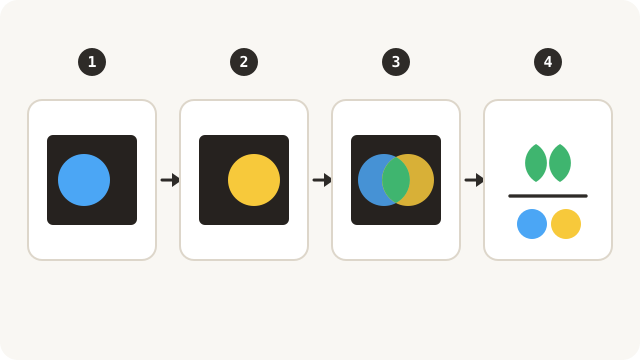

# The Dice score

*A mark between 0 and 1 telling how much two areas overlap: what the model marked, and what should have been marked.*

## The idea

The Dice score compares two areas: the one the model marked as ink, and the one in the label. It is 1 if they coincide exactly, 0 if they do not touch. The measure comes from ecology (Lee R. Dice, 1945) and became the usual mark for tasks that cut an image into regions.

## How it works

1. **The prediction**: the area the model marks.
2. **The label**: the expected area.
3. **The overlap**: the part common to both.
4. **The mark**: twice the overlap divided by the sum of the two areas.

*Numbers refer to the plate.*

## Why it matters here

The word appears in three places that must be told apart. In our own training, Dice is one of the two loss terms, with cross-entropy (K-13): the villa code combines them, Dice being counted as a negative term (the better the overlap, the lower the loss). In the segmentation tutorials a "pseudo Dice" is computed on a random validation batch; the page itself warns not to take it as gospel. Finally the open problems page quotes a validation Dice "nearly doubled" by a swarm of agents, stating it is computed on pseudo-labels (K-09). This is consistent with the definition, but the limit is real: a mark measured against model-derived labels says two models agree, not that ink is really there. No absolute value is given.
