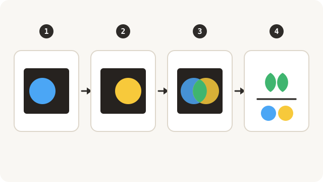

# Le score Dice

*Une note entre 0 et 1 qui dit à quel point deux zones se recouvrent : ce que le modèle a marqué, et ce qu'il fallait marquer.*

## L'idée

Le score Dice compare deux zones : celle que le modèle a marquée comme encre, et celle de l'étiquette. Il vaut 1 si elles coïncident exactement, 0 si elles ne se touchent pas. La mesure vient de l'écologie (Lee R. Dice, 1945) ; elle est devenue la note habituelle des tâches où l'on découpe une image en zones.

## Comment ça marche

1. **La prédiction** : la zone que le modèle marque.
2. **L'étiquette** : la zone attendue.
3. **Le recouvrement** : la partie commune aux deux.
4. **La note** : deux fois le recouvrement, divisé par la somme des deux surfaces.

*Les numéros renvoient à la planche.*

## Pourquoi ça compte ici

Le mot apparaît à trois endroits, et il faut les distinguer. Dans notre propre entraînement, le Dice est un des deux termes de la perte, avec l'entropie croisée (K-13) : le code de villa les additionne. Dans les tutoriels de segmentation, un « pseudo Dice » est calculé sur un lot de validation tiré au hasard ; la page prévient elle-même de ne pas le prendre pour parole d'évangile. Enfin la page des problèmes ouverts cite un Dice de validation « presque doublé » par un essaim d'agents, en précisant qu'il est calculé sur des pseudo-étiquettes (K-09). C'est cohérent avec la définition, mais la limite est réelle : une note mesurée contre des étiquettes issues d'un modèle dit que deux modèles s'accordent, pas que l'encre est bien là. Aucune valeur absolue n'est donnée.

## Le vocabulaire anglais

| Anglais | Français |
|---|---|
| *Dice score* | score Dice |
| *overlap* | recouvrement |
| *F1 score* | autre nom de la même mesure |
| *IoU, Jaccard* | mesure voisine : recouvrement divisé par l'union |
| *pseudo Dice* | Dice estimé sur un échantillon, à lire avec prudence |
