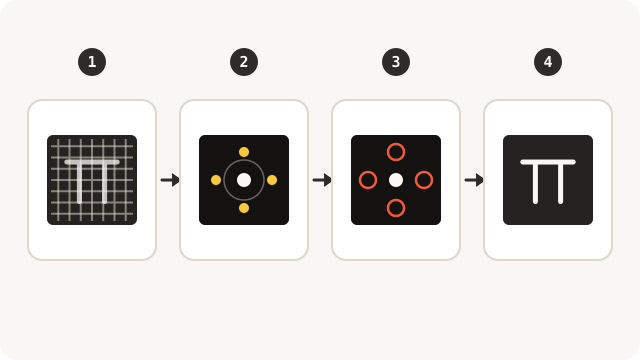

# The papyrus weave, and how to remove it

*Papyrus fibres draw a regular grid that the model partly mistakes for ink. An idea of ours, not tried yet: take it out.*

## The idea

A papyrus sheet is made of two crossed layers of fibres: horizontal on the recto, where the writing is, vertical on the verso. On our ink image X-003 this grid shows everywhere, and the model gives it a middling answer where it should answer "no ink". Kanemonium's idea: detect this weave, then remove it, to keep only what is not it.

## How it works

1. **The ink image** mixes two things: letter shapes, and a regular grid caused by fibres.
2. **A repeating pattern** is easier to recognise another way: split into frequencies, the image shows periodic noise as a few isolated bright spikes.
3. **A notch filter** masks those spikes, and only them.
4. **Back in the image**, the repeating pattern is strongly reduced. What was not regular, such as a letter, stays.

*Numbers refer to the plate.*

## Why it matters here

This is a direction; nothing is measured. Two caveats come from the source on filtering: some noise may remain along the borders, and removing fine detail is a trade-off. A third applies to us: the fibres of a carbonised papyrus are not perfectly regular, so they may not reduce to a few spikes. Two other routes already exist on the team side, which we have not tried: a model that recognises horizontal and vertical fibres, and a four-class model that learns background, both kinds of fibre and ink together, where ink wins over fibre. We found nobody removing the weave from an ink map; the search covered the challenge pages, the prize history, villa code and proposals, and five searches on Discord.
