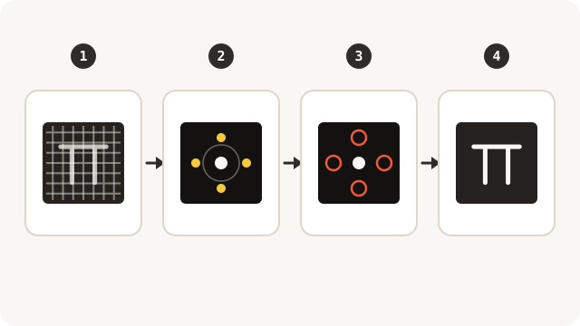

# La trame du papyrus, et comment l’effacer

*Les fibres du papyrus dessinent un quadrillage régulier que le modèle confond en partie avec l'encre. Une idée à nous, pas encore essayée : l'enlever.*

## L'idée

Une feuille de papyrus est faite de deux couches de fibres croisées : horizontales au recto, où l'on écrit, verticales au verso. Sur notre image d'encre X-003, ce quadrillage se voit partout, et le modèle lui donne une réponse moyenne là où il devrait répondre « pas d'encre ». L'idée de Kanemonium : repérer cette trame, puis la retirer, pour ne garder que ce qui n'est pas elle.

## Comment ça marche

1. **L'image d'encre** mêle deux choses : des formes de lettres, et un quadrillage régulier dû aux fibres.
2. **Un motif qui se répète** se reconnaît mieux autrement : décomposée en fréquences, l'image montre le bruit périodique sous forme de quelques points brillants isolés.
3. **Un filtre coupe-bande** masque ces points, et eux seuls.
4. **De retour à l'image**, le motif répété est fortement réduit. Ce qui n'était pas régulier, comme une lettre, reste.

*Les numéros renvoient à la planche.*

## Pourquoi ça compte ici

C'est une piste, rien n'est mesuré. Deux réserves viennent de la source sur le filtrage : il peut rester du bruit sur les bords, et retirer du détail fin est un compromis. Chez nous s'en ajoute une troisième : les fibres d'un papyrus carbonisé ne sont pas parfaitement régulières, donc elles ne se réduiront peut-être pas à quelques points. Deux autres voies existent déjà du côté de l'équipe, que nous n'avons pas essayées : un modèle qui reconnaît les fibres horizontales et verticales, et un modèle à quatre classes qui apprend ensemble le fond, les deux sortes de fibres et l'encre, où l'encre l'emporte sur la fibre. Nous n'avons trouvé personne qui retire la trame d'une carte d'encre ; la recherche a porté sur les pages du défi, l'historique des prix, le code et les propositions de villa, et cinq recherches sur le Discord.

## Le vocabulaire anglais

| Anglais | Français |
|---|---|
| *fiber* | fibre |
| *periodic noise* | bruit périodique : un motif qui se répète |
| *frequency domain* | domaine des fréquences : l'image décrite par ses répétitions |
| *notch filter* | filtre coupe-bande |
| *destriping* | suppression de rayures |
