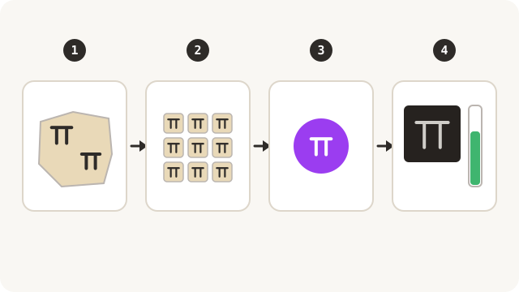

# Greek letter datasets

*Hundreds of thousands of Greek letters cropped from other papyri. Useful to judge an ink map, dangerous to produce one.*

## The idea

AL-PUB v2 is a public set of 205,797 images of Greek letters, tightly cropped from 12,070 fragments of the Oxyrhynchus Papyri, thanks to volunteer annotations from the Ancient Lives project. All 24 letters are there, with the lunate sigma in place of the usual sigma. It was built with machine learning and character recognition in mind.

## How it works

1. **Readable papyri**, from another collection than ours: their writing is visible to the eye.
2. **Letters cropped** one by one and classified by volunteers.
3. **A model** can learn from them to recognise the shape of a Greek letter.
4. **Applied afterwards** to an ink map, it would give each window a score: does this look like writing?

*Numbers refer to the plate.*

## Why it matters here

Where this model sits is decisive. Putting it inside the ink detector would be exactly what the challenge rules try to prevent: a model that knows letters can draw some where there is nothing (K-21). The idea is only defensible downstream, to triage or score maps already produced, never to produce them. Two more caveats: these letters come from Oxyrhynchus, not Herculaneum, and we verified nothing about how similar the scripts are; the set is under the Apache 2.0 licence and must be cited. A participant announced related work, a "legibility index" scoring windows of official ink maps; we have not opened it. We found no mention of AL-PUB in the challenge pages, villa code and proposals, or on Discord.
