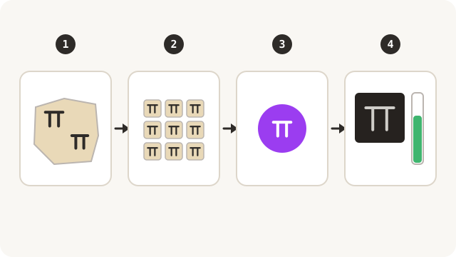

# Les jeux de lettres grecques

*Des centaines de milliers de lettres grecques découpées sur d'autres papyrus. Utiles pour juger une carte d'encre, dangereuses pour la produire.*

## L'idée

AL-PUB v2 est un jeu public de 205 797 images de lettres grecques, découpées au plus près sur 12 070 fragments des papyrus d'Oxyrhynque, grâce aux annotations de volontaires du projet Ancient Lives. Les 24 lettres y sont, avec le sigma lunaire à la place du sigma habituel. Il a été conçu pour l'apprentissage automatique et la reconnaissance de caractères.

## Comment ça marche

1. **Des papyrus lisibles**, d'une autre collection que la nôtre : leur écriture se voit à l'œil.
2. **Des lettres découpées** une à une et classées par des volontaires.
3. **Un modèle** peut apprendre sur elles à reconnaître la forme d'une lettre grecque.
4. **Appliqué après coup** à une carte d'encre, il donnerait une note à chaque fenêtre : cela ressemble-t-il à de l'écriture ?

*Les numéros renvoient à la planche.*

## Pourquoi ça compte ici

La place de ce modèle est décisive. Le mettre dans le détecteur d'encre serait exactement ce que les règles du défi veulent empêcher : un modèle qui connaît les lettres peut en dessiner là où il n'y a rien (K-21). L'idée n'est défendable qu'en aval, pour trier ou noter des cartes déjà produites, jamais pour les produire. Deux réserves de plus : ces lettres viennent d'Oxyrhynque, pas d'Herculanum, et nous n'avons rien vérifié sur la ressemblance des écritures ; le jeu est sous licence Apache 2.0, à citer. Un participant a annoncé un travail voisin, un « indice de lisibilité » qui note des fenêtres de cartes d'encre officielles ; nous ne l'avons pas ouvert. Nous n'avons trouvé aucune mention d'AL-PUB dans les pages du défi, le code et les propositions de villa, ni sur le Discord.

## Le vocabulaire anglais

| Anglais | Français |
|---|---|
| *character recognition, OCR* | reconnaissance de caractères |
| *crowdsourced annotations* | annotations de volontaires |
| *lunate sigma* | sigma lunaire, en forme de C |
| *downstream* | en aval : après la détection |
| *legibility* | lisibilité |
