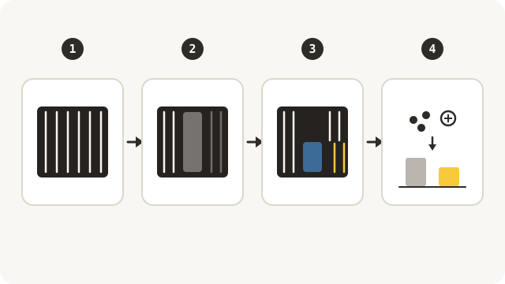

# Two numbers per material: absorb and shift

*To X-rays, a material comes down to two numbers: how much it absorbs and how much it shifts the wave. Both can be computed.*

## The idea

For an X-ray, a material is described by a two-part index, written n = 1 − δ + iβ ([Wikipedia, Refractive index](https://en.wikipedia.org/wiki/Refractive_index)). β says how much the material absorbs. δ says how much it shifts the wave going through it ([Wikipedia, Phase-contrast X-ray imaging](https://en.wikipedia.org/wiki/Phase-contrast_X-ray_imaging)). These are the "theoretical values" Kanemonium asked for in P-370: they exist.

## How it works

1. **The wave arrives**, well aligned.
2. **Absorb**: the material keeps part of it, the wave comes out weaker. This is β, and it is what an ordinary radiograph shows.
3. **Shift**: the part of the wave that crossed the material comes out late compared with its neighbour. This is δ, and it is what phase contrast makes visible (K-05).
4. **From material to two numbers**: the Berkeley lab tables compute the index of a compound from its chemical formula and density ([CXRO](https://henke.lbl.gov/optical_constants/getdb2.html)).

*Numbers refer to the plate.*

## Why it matters here

Three caveats for us. These tables stop at 30 keV, while the scrolls were scanned between roughly 53 and 110 keV ([2023 scan announcement](https://scrollprize.substack.com/p/new-scans-of-herculaneum-papyri-at), [the challenge's open problems](https://scrollprize.org/2026_open_problems)): other tables are needed, which we have not looked for. The computation needs the density, which we know neither for our papyrus nor for its ink. Above all, the ink is made of smoke residues, carbon-based, with a density almost equal to that of the charred papyrus ([ESRF, 2015](https://www.esrf.fr/home/UsersAndScience/Publications/Highlights/highlights-2015/cbs/cbs10.html)): the two numbers of the two materials are very likely close. δ is tied to the number of electrons per volume, so to density far more than to the element (source read: Wikipedia only). Nothing is computed on our side.
