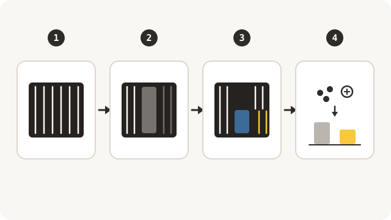

# Deux nombres par matière : absorber et décaler

*Aux rayons X, une matière se résume à deux nombres : ce qu'elle absorbe et de combien elle décale l'onde. Les deux se calculent.*

## L'idée

Pour un rayon X, une matière se décrit par un indice à deux parties, écrit n = 1 − δ + iβ ([Wikipédia, Refractive index](https://en.wikipedia.org/wiki/Refractive_index)). β dit combien la matière absorbe. δ dit de combien elle décale l'onde qui la traverse ([Wikipédia, Phase-contrast X-ray imaging](https://en.wikipedia.org/wiki/Phase-contrast_X-ray_imaging)). Ce sont les « valeurs théoriques » que Kanemonium demandait dans P-370 : elles existent.

## Comment ça marche

1. **L'onde arrive**, bien alignée.
2. **Absorber** : la matière en retient une partie, l'onde ressort affaiblie. C'est β, et c'est ce que montre une radiographie ordinaire.
3. **Décaler** : la partie de l'onde qui a traversé la matière ressort en retard sur sa voisine. C'est δ, et c'est ce que le contraste de phase rend visible (K-05).
4. **De la matière aux deux nombres** : les tables du laboratoire de Berkeley calculent l'indice d'un composé à partir de sa formule chimique et de sa densité ([CXRO](https://henke.lbl.gov/optical_constants/getdb2.html)).

*Les numéros renvoient à la planche.*

## Pourquoi ça compte ici

Trois réserves pour notre cas. Ces tables s'arrêtent à 30 keV, alors que les rouleaux ont été scannés entre 53 et 110 keV environ ([annonce des scans de 2023](https://scrollprize.substack.com/p/new-scans-of-herculaneum-papyri-at), [problèmes ouverts du défi](https://scrollprize.org/2026_open_problems)) : il faudra d'autres tables, que nous n'avons pas cherchées. Le calcul demande la densité, que nous ne connaissons ni pour notre papyrus ni pour son encre. Et surtout, l'encre est faite de résidus de fumée, à base de carbone, d'une densité presque égale à celle du papyrus carbonisé ([ESRF, 2015](https://www.esrf.fr/home/UsersAndScience/Publications/Highlights/highlights-2015/cbs/cbs10.html)) : les deux nombres des deux matières ont toutes les chances d'être voisins. δ est lié au nombre d'électrons par volume, donc à la densité bien plus qu'à l'élément (source lue : Wikipédia seulement). Rien n'est calculé chez nous.

## Le vocabulaire anglais

| Anglais | Français |
|---|---|
| *refractive index* | indice de réfraction |
| *absorption* | absorption (β) |
| *phase shift* | décalage de phase (δ) |
| *electron density* | densité d'électrons |
| *optical constants* | constantes optiques : les tables de ces nombres |
