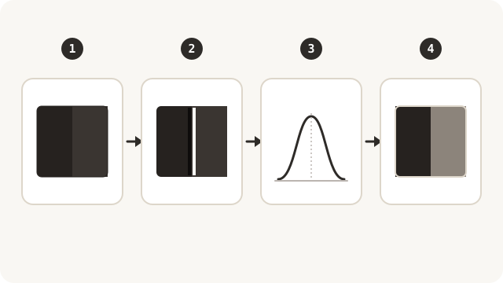

# Phase retrieval: a filter is enough

*Going from phase-contrast fringes to a contrasted image comes down, in the simple case, to applying a filter. On the recent scans of the challenge, it is already done.*

## The idea

Kanemonium asked whether the physics of the scan could be simplified into a convolution. For one step, yes, and it has a name: the Paganin method. It applies a low-pass filter, in Fourier space, to a single phase-contrast image, assuming the object is made of a single material ([Beltran, Paganin and Pelliccia](https://ar5iv.labs.arxiv.org/html/1711.04227)).

## How it works

1. **Two neighbouring materials** absorb almost the same: on an ordinary radiograph their border barely shows.
2. **After propagation**, the border is underlined by a bright and dark fringe (K-05).
3. **The filter** lets slow variations through and attenuates fast ones. Its setting is the δ/β ratio of the assumed material (K-29).
4. **The result**: fringes vanish, contrast and signal-to-noise ratio rise, at the cost of reduced apparent sharpness ([Angelotti, Parsons, Nicolardi et al., 2026](https://arxiv.org/abs/2606.29085)).

*Numbers refer to the plate.*

## Why it matters here

This filter is not a margin left to us: on the recent scans made at ESRF, the team already applied it (δ/β ratio of 1000), then sharpened the images, before reconstructing the volume ([same preprint](https://arxiv.org/abs/2606.29085)). It is applied to each projection, before reconstruction; and the projections are not published (K-31). So we cannot redo it with another setting. For the 2023 scans made at Diamond, the paper describing them says the phase shift is present without having been amplified ([EduceLab-Scrolls](https://ar5iv.labs.arxiv.org/html/2304.02084)); we did not find whether such a filter was applied to them. Which scan the tutorial segment comes from: to be checked (T-018). We did not read the original 2002 paper, only its description by its authors.
