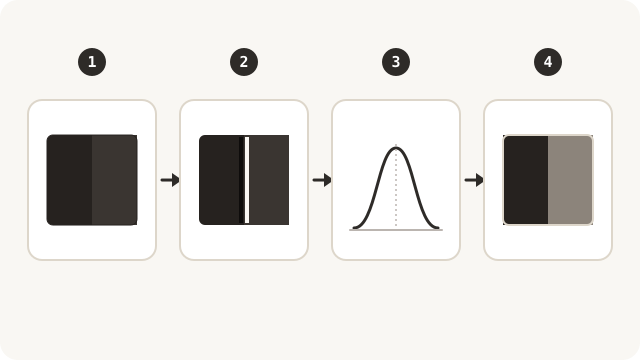

# Retrouver la phase : un filtre suffit

*Passer des franges du contraste de phase à une image contrastée revient, dans le cas simple, à appliquer un filtre. Sur les scans récents du défi, c'est déjà fait.*

## L'idée

Kanemonium demandait si la physique du scan pouvait se simplifier en une convolution. Pour une étape, oui, et elle porte un nom : la méthode de Paganin. Elle applique un filtre passe-bas, dans l'espace des fréquences, à une seule image de contraste de phase, en supposant que l'objet est fait d'une seule matière ([Beltran, Paganin et Pelliccia](https://ar5iv.labs.arxiv.org/html/1711.04227)).

## Comment ça marche

1. **Deux matières voisines** absorbent presque autant : sur une radiographie ordinaire, leur frontière se voit à peine.
2. **Après propagation**, la frontière est soulignée d'une frange claire et sombre (K-05).
3. **Le filtre** laisse passer les variations lentes et atténue les rapides. Son réglage est le rapport δ/β de la matière supposée (K-29).
4. **Le résultat** : les franges disparaissent, le contraste et le rapport signal sur bruit montent, au prix d'une netteté apparente réduite ([Angelotti, Parsons, Nicolardi et al., 2026](https://arxiv.org/abs/2606.29085)).

*Les numéros renvoient à la planche.*

## Pourquoi ça compte ici

Ce filtre n'est pas une marge qui nous reste : sur les scans récents faits à l'ESRF, l'équipe l'a déjà appliqué (rapport δ/β de 1000), puis a redonné de la netteté aux images, avant de reconstruire le volume ([même prépublication](https://arxiv.org/abs/2606.29085)). Il s'applique à chaque projection, avant la reconstruction ; or les projections ne sont pas publiées (K-31). Nous ne pouvons donc pas le refaire avec un autre réglage. Pour les scans de 2023 faits à Diamond, l'article qui les décrit dit que le décalage de phase y est présent sans avoir été amplifié ([EduceLab-Scrolls](https://ar5iv.labs.arxiv.org/html/2304.02084)) ; nous n'avons pas trouvé si un tel filtre leur a été appliqué. De quel scan vient le segment du tutoriel : à vérifier (T-018). Nous n'avons pas lu l'article d'origine de 2002, seulement sa description par ses auteurs.

## Le vocabulaire anglais

| Anglais | Français |
|---|---|
| *phase retrieval* | reconstruction de phase |
| *low-pass filter* | filtre passe-bas : il garde les variations lentes |
| *single-material assumption* | hypothèse d'une seule matière |
| *unsharp mask* | masque flou : un traitement qui redonne de la netteté |
| *signal-to-noise ratio* | rapport signal sur bruit |
