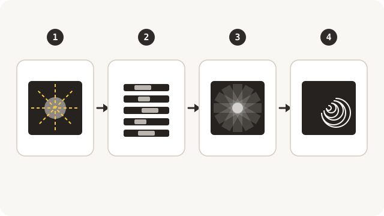

# From projections to the volume

*The scanner does not record a volume but shadows taken from many angles. The volume is computed afterwards, and it alone is published.*

## The idea

Kanemonium proposed to simulate the beam in every direction, as the scanner does, to lift the blur. That family of methods exists: iterative reconstruction. It needs what the scanner actually recorded, the projections, and those of the scrolls are not published.

## How it works

1. **The scanner** sends the beam through the object from many angles (K-03).
2. **The projections**: one shadow per angle. Put together they form a sinogram ([Wikipedia, Tomographic reconstruction](https://en.wikipedia.org/wiki/Tomographic_reconstruction)).
3. **Reconstruction** crosses these shadows back to recover the inside. The common way is filtered back-projection. The iterative way corrects the image from the difference between computed and actual projections: better, but more expensive ([Wikipedia, Iterative reconstruction](https://en.wikipedia.org/wiki/Iterative_reconstruction)).
4. **The volume**: this is what the challenge publishes, and what we read in chunks (K-10).

*Numbers refer to the plate.*

## Why it matters here

The challenge's open data repository says it: raw projections are "currently not shared", nor are the reconstructed volumes before masking ([ScrollPrize/open-data](https://github.com/ScrollPrize/open-data)). Since the iterative method compares against the actual projections, we infer it cannot be done from the volume alone: that is our reading, not a sentence from a source. One exception noted, to be checked: for a test scroll made by the team ("campfire", not a Herculaneum scroll), the raw X-ray photos would be published. It would be the only ground on which to try this part of the idea. Without projections, what remains is to work on the volume itself (K-32).
