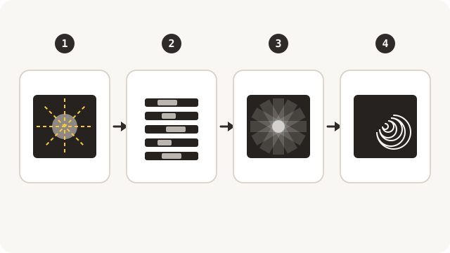

# Des projections au volume

*Le scanner n'enregistre pas un volume mais des ombres prises sous beaucoup d'angles. Le volume est calculé ensuite, et c'est lui seul qui est publié.*

## L'idée

Kanemonium proposait de simuler le faisceau dans toutes les directions, comme le scanner, pour lever le flou. Cette famille de méthodes existe : c'est la reconstruction itérative. Elle a besoin de ce que le scanner a réellement enregistré, les projections, et celles des rouleaux ne sont pas publiées.

## Comment ça marche

1. **Le scanner** envoie le faisceau à travers l'objet sous de nombreux angles (K-03).
2. **Les projections** : une ombre par angle. Rangées ensemble, elles forment un sinogramme ([Wikipédia, Tomographic reconstruction](https://en.wikipedia.org/wiki/Tomographic_reconstruction)).
3. **La reconstruction** recroise ces ombres pour retrouver l'intérieur. La façon courante est la rétroprojection filtrée. La façon itérative corrige l'image d'après l'écart entre les projections calculées et les projections réelles : meilleure, mais plus coûteuse ([Wikipédia, Iterative reconstruction](https://en.wikipedia.org/wiki/Iterative_reconstruction)).
4. **Le volume** : c'est ce que le défi publie, et ce que nous lisons par morceaux (K-10).

*Les numéros renvoient à la planche.*

## Pourquoi ça compte ici

Le dépôt des données ouvertes du défi le dit : les projections brutes ne sont « actuellement pas partagées », ni les volumes reconstruits avant masquage ([ScrollPrize/open-data](https://github.com/ScrollPrize/open-data)). Puisque la méthode itérative compare aux projections réelles, nous en déduisons qu'elle n'est pas faisable à partir du seul volume : c'est notre lecture, pas une phrase d'une source. Une exception relevée, à vérifier : pour un rouleau d'essai fabriqué par l'équipe (« campfire », pas un rouleau d'Herculanum), les photos brutes aux rayons X seraient publiées. Ce serait le seul terrain où essayer cette partie de l'idée. Sans projections, il reste à travailler sur le volume lui-même (K-32).

## Le vocabulaire anglais

| Anglais | Français |
|---|---|
| *projection* | projection : une ombre prise sous un angle |
| *sinogram* | sinogramme : toutes les projections rangées ensemble |
| *filtered back-projection* | rétroprojection filtrée |
| *iterative reconstruction* | reconstruction itérative |
| *raw data* | données brutes |
