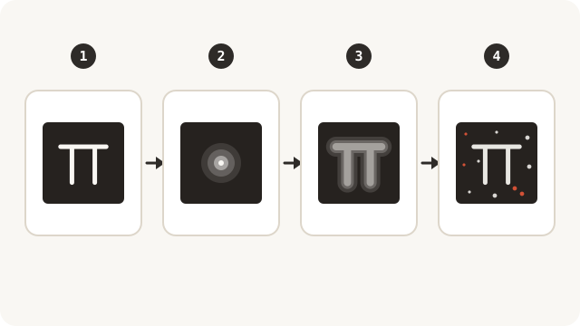

# Blur is a convolution

*A blurred image is the sharp image spread by a spot. Knowing the spot lets one attempt the inverse operation, which also amplifies noise.*

## The idea

An instrument never records a point as a point: it spreads it into a small spot. The image obtained is the perfect image convolved with that spot, and deconvolution is the inverse operation ([Wikipedia, Deconvolution](https://en.wikipedia.org/wiki/Deconvolution)). This is what is left of the "sharp version of the scroll" idea when only the volume is available (K-31).

## How it works

1. **The perfect image**, the one an ideal instrument would give.
2. **The spot**: how the instrument spreads a point.
3. **The actual image**: every point of the perfect image, replaced by the spot. This is a convolution.
4. **Deconvolution** tries to undo that spreading. It gives sharpness back, but inverting a filter also amplifies errors: noise comes out.

*Numbers refer to the plate.*

## Why it matters here

Nothing has been tried. Three caveats. We do not know the spot of these scans. The veil of compressed regions comes, according to the team, from the beam being scattered by packed fibres (P-110): nothing says it reduces to one fixed spot, the same everywhere. And recent volumes already received a smoothing filter followed by a sharpening step (K-30): deblurring on top may mostly bring out noise. A trial would have a ready-made judge: the ink model's score on the held-out regions (K-16).
