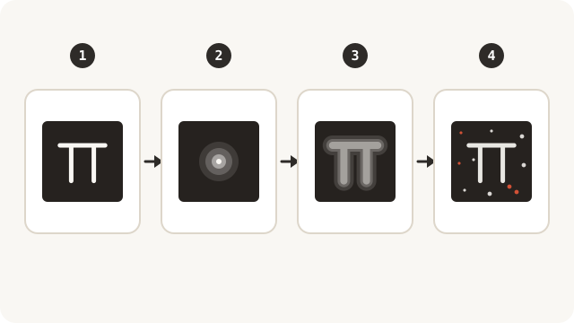

# Le flou est une convolution

*Une image floue est l'image nette étalée par une tache. Connaître la tache permet de tenter l'opération inverse, qui amplifie aussi le bruit.*

## L'idée

Un instrument n'enregistre jamais un point comme un point : il l'étale en une petite tache. L'image obtenue est l'image parfaite convoluée par cette tache, et la déconvolution est l'opération inverse ([Wikipédia, Deconvolution](https://en.wikipedia.org/wiki/Deconvolution)). C'est ce qui reste de l'idée de « version nette du rouleau » quand on n'a que le volume (K-31).

## Comment ça marche

1. **L'image parfaite**, celle qu'un instrument idéal donnerait.
2. **La tache** : la façon dont l'instrument étale un point.
3. **L'image réelle** : chaque point de l'image parfaite, remplacé par la tache. C'est une convolution.
4. **La déconvolution** cherche à défaire cet étalement. Elle redonne de la netteté, mais inverser un filtre amplifie aussi les erreurs : le bruit ressort.

*Les numéros renvoient à la planche.*

## Pourquoi ça compte ici

Rien n'est essayé. Trois réserves. Nous ne connaissons pas la tache de ces scans. Le voile des zones compressées vient, d'après l'équipe, de la dispersion du faisceau par les fibres tassées (P-110) : rien ne dit qu'il se réduise à une tache fixe, la même partout. Et les volumes récents ont déjà reçu un filtre qui lisse puis un traitement qui redonne de la netteté (K-30) : déflouter par-dessus peut surtout faire ressortir du bruit. Un essai aurait un juge tout trouvé : la note du modèle d'encre sur les régions mises de côté (K-16).

## Le vocabulaire anglais

| Anglais | Français |
|---|---|
| *point spread function (PSF)* | fonction d'étalement du point : la tache |
| *convolution* | convolution |
| *deconvolution* | déconvolution |
| *noise amplification* | amplification du bruit |
| *scattering* | dispersion, diffusion du faisceau |
