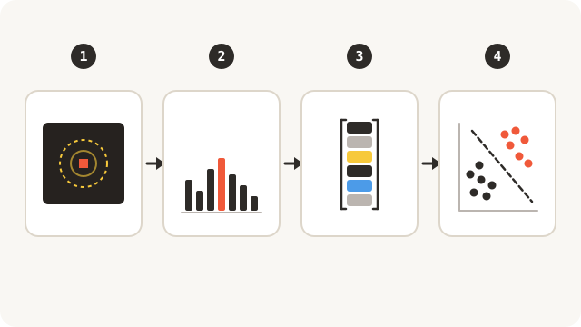

# One vector per pixel

*Describe each pixel by a few measurements taken around it, then let a simple classifier separate ink from background: a classical method that can be read one dimension at a time.*

## The idea

Kanemonium's idea (P-380) has a name in image analysis: pixel classification. Each pixel gets a list of measurements, and a classifier learns, from a few annotations, to sort pixels into classes. The ilastik software does exactly that, with a random forest trained on the user's annotations ([ilastik documentation](https://www.ilastik.org/documentation/pixelclassification/pixelclassification)).

## How it works

1. **A pixel and its neighbourhood**, looked at on several scales: close up, then from further away.
2. **Measurements**: intensity, edge strength, texture, each on several scales. We add the depth profile: the value of each layer above and below the surface (K-07).
3. **The vector**: these measurements, put end to end. Two pixels with the same mean value can have two different vectors.
4. **A simple classifier** looks for the border that separates the classes. It can be asked which dimensions it uses.

*Numbers refer to the plate.*

## Why it matters here

A network (K-11) also builds vectors, with thousands of dimensions, without saying which ones matter. Here there are few, and the contribution of each is measured. Related work exists in the community, which we have not read beyond its presentation on [the challenge's projects page](https://scrollprize.org/community_projects): a visualisation of ink vectors clustered to tell ink from the rest ([Seth Stewart](https://github.com/StewartSethA/ink-seer)), and a detection pipeline using classical approaches, without deep learning ("Omit", by Timo Meireman). A 2019 paper already measured a subtle but detectable signature of carbon ink in micro-CT, on laboratory-made samples ([Parker, Parsons et al.](https://journals.plos.org/plosone/article?id=10.1371/journal.pone.0215775)). Our trial is task T-017, judged on the same held-out regions as the model (K-16). Nothing is measured.
