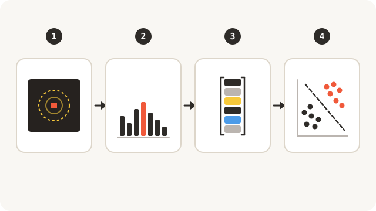

# Un vecteur par pixel

*Décrire chaque pixel par quelques mesures prises autour de lui, puis laisser un classifieur simple séparer l'encre du fond : une méthode classique, que l'on peut lire dimension par dimension.*

## L'idée

L'idée de Kanemonium (P-380) a un nom en analyse d'images : la classification de pixels. Chaque pixel reçoit une liste de mesures, et un classifieur apprend, à partir de quelques annotations, à ranger les pixels en classes. Le logiciel ilastik fait exactement cela, avec une forêt aléatoire entraînée sur les annotations de l'utilisateur ([documentation d'ilastik](https://www.ilastik.org/documentation/pixelclassification/pixelclassification)).

## Comment ça marche

1. **Un pixel et son voisinage**, regardé à plusieurs échelles : de près, puis de plus loin.
2. **Des mesures** : l'intensité, la force des bords, la texture, chacune à plusieurs échelles. Chez nous s'ajoute le profil en profondeur : la valeur de chaque couche au-dessus et au-dessous de la surface (K-07).
3. **Le vecteur** : ces mesures, mises bout à bout. Deux pixels de même valeur moyenne peuvent avoir deux vecteurs différents.
4. **Un classifieur simple** cherche la frontière qui sépare les classes. On peut lui demander quelles dimensions lui servent.

*Les numéros renvoient à la planche.*

## Pourquoi ça compte ici

Un réseau (K-11) fabrique lui aussi des vecteurs, par milliers de dimensions, sans dire lesquelles comptent. Ici il y en a peu, et on mesure l'apport de chacune. Des travaux proches existent dans la communauté, que nous n'avons pas lus au-delà de leur présentation sur [la page des projets du défi](https://scrollprize.org/community_projects) : une visualisation de vecteurs d'encre regroupés pour distinguer l'encre du reste ([Seth Stewart](https://github.com/StewartSethA/ink-seer)), et une chaîne de détection par des approches classiques, sans apprentissage profond (« Omit », de Timo Meireman). Un article de 2019 mesurait déjà une signature faible mais détectable de l'encre au carbone en micro-tomographie, sur des échantillons faits en laboratoire ([Parker, Parsons et al.](https://journals.plos.org/plosone/article?id=10.1371/journal.pone.0215775)). Notre essai est la tâche T-017, jugé sur les mêmes régions mises de côté que le modèle (K-16). Rien n'est mesuré.

## Le vocabulaire anglais

| Anglais | Français |
|---|---|
| *pixel classification* | classification de pixels |
| *feature* | descripteur : une mesure faite autour du pixel |
| *feature vector* | vecteur de descripteurs |
| *random forest* | forêt aléatoire : un classifieur fait de nombreux arbres de décision |
| *scale* | échelle : la taille du voisinage regardé |
